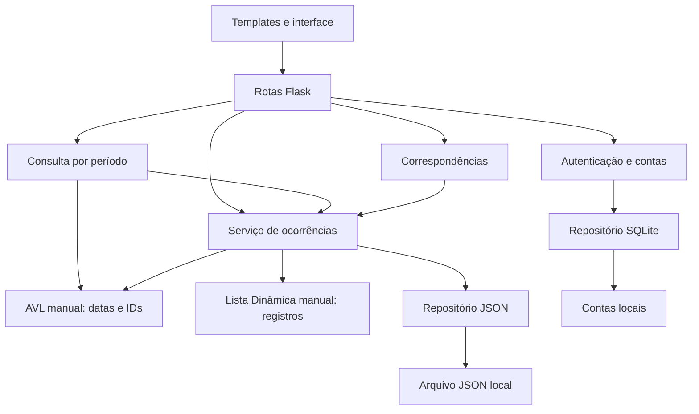

# Arquitetura e desenvolvimento em paralelo

## Atualização SCRUM-9 — 27/10/2026

`structures/lista_dinamica.py` contém `ListaDinamica[T]` manual, com buffer fixo,
expansão, deslocamento, busca e filtros por predicado. A porta original permanece
compatível. Modelo e núcleo da SCRUM-8 foram testados com a Lista real por um
adaptador exclusivo dos testes. O contrato de produção Lista/AVL/JSON continua
em SCRUM-13; nenhuma rota foi adicionada. Consulte [o guia](scrum-9.md).

## Atualização SCRUM-8 — 27/10/2026

`models/ocorrencia.py` contém o modelo e codec sem I/O;
`models/alteracao_ocorrencias.py` contém lotes imutáveis e validação de snapshots;
`services/nucleo_ocorrencias.py` contém operações internas preparadas por lote.
Não há novo armazenamento de produção. A porta `ArmazenamentoOcorrenciasPorta`
será implementada por SCRUM-13 usando Lista/AVL/JSON; os fakes atuais existem
somente em testes. O serviço autenticado de SCRUM-16 envolverá o núcleo,
validará uploads e só então poderá expor rotas. Veja [o contrato](scrum-8.md).

Por decisão vigente de 19/10/2026 informada pelo usuário, contas também usam
JSON. As referências a SQLite no desenho histórico abaixo estão superadas;
a adequação dos esboços/configuração pertence ao responsável pelas contas.

## Base informada e organização técnica

A arquitetura aprovada é um monólito web em camadas, com Flask, Jinja2,
HTML/CSS/JavaScript e Bootstrap 5. Ocorrências persistem em JSON, contas
administrativas em SQLite; Lista Dinâmica e AVL são manuais.

As fronteiras, nomes de protocolos, mecanismos de injeção e sequência de
gravação abaixo são **propostas técnicas v0 desta preparação**, a serem
revisadas pelos responsáveis. Elas não acrescentam regras de negócio.

Modelos e erros são compartilhados entre os módulos de domínio. Eles não
dependem de Flask, serviços ou persistência. Correspondência recebe a
`LeituraOcorrenciasPorta`, contendo apenas `obter` e `listar`, sem métodos
de mutação ou acesso a arquivos.
O serviço de consultas resolve os IDs pela leitura de ocorrências; não
precisa conhecer os nós da árvore. Templates recebem apenas a visão pública
dos dados, preparada pelas rotas/serviços, nunca hashes de contas.

## Ajustes decorrentes da análise crítica

| Problema de integração | Ajuste proposto antes da implementação dos módulos |
| --- | --- |
| CRUD na Lista e CRUD no JSON poderiam competir pela coordenação | Um serviço de ocorrências coordena alterações; Lista é armazenamento em memória e repositório é I/O. Marcelo implementa CRUD do domínio com revisão de Luís |
| Matheus precisaria importar detalhes da Lista e dos nós AVL no repositório | Manter JSON independente das estruturas; integração JSON -> Lista -> AVL em `services/inicializacao.py`, de Matheus com revisão dos responsáveis |
| Exclusão de um item muda posições na Lista e invalida referências da AVL | AVL guarda IDs opacos estáveis, nunca posições da Lista nem objetos mutáveis como fonte principal |
| Mesmo dia pode ter várias ocorrências | Índice recebe pares `(data, id)`; Leandro define buckets ou chave composta e testa duplicatas sem trocar a AVL por estrutura pronta |
| Resolver/reabrir um vínculo pode salvar só metade da alteração | Uma operação de serviço coordena ambos os registros e um snapshot persistido; estratégia de falha precisa ser definida antes das rotas |
| Data do índice e campos ainda não aprovados bloqueariam todos os módulos | AVL trabalha com `date` externo; integração recebe `extrair_data`. Modelo completo e DTOs só após revisão da equipe |
| Estado global importado contaminaria testes e criaria ciclos | Fábrica cria dependências por instância; protocolos e injeção de construtor permitem fakes. Futuramente um serviço por app em `app.extensions`, sem singleton global |
| Luís concentraria todas as mudanças de integração | Marcelo mantém seu serviço CRUD; Matheus mantém inicialização; Leandro consultas; André correspondência e integração; Luís revisa composição e segurança |

`obter(id)` pode inicialmente percorrer a Lista, custo O(n); não prometemos
consulta por ID em O(1). A AVL acelera seleção temporal, mas a resolução de
k IDs por varreduras pode custar O(k*n). Um auxiliar de resolução de IDs
pode ser avaliado com o professor, sem substituir a Lista ou a AVL nem
esconder o custo na apresentação acadêmica.

## Ciclo de vida proposto, ainda não implementado

Inicialização futura: JSON -> validação/decodificação -> Lista manual ->
reconstrução da AVL com chave de data aprovada -> exposição dos serviços.
A AVL é derivada e não deve ser serializada com nós e ponteiros no JSON.
O SQLite de contas tem inicialização separada e não armazena ocorrências.

Em uma mutação, o serviço valida dados, ator e regras; prepara a alteração
incluindo pares vinculados; mantém Lista, índice e snapshot coerentes.
O repositório salva um snapshot completo por chamada. A proposta é escrita
em arquivo temporário no mesmo diretório e substituição atômica, com estratégia
de rollback ou preparação isolada para falhas. `os.replace` sozinho não
sincroniza a memória nem torna duas requisições uma transação.

Para a primeira integração, propõe-se **um processo da aplicação** e um
lock de serviço envolvendo mutações e leituras coerentes. Vários workers
teriam Listas e AVLs independentes e poderiam sobrescrever JSON. Nem lock
de thread nem escrita atômica isolada resolvem divergência entre processos.
Uso simultâneo, backup e requisitos de implantação precisam de revisão;
esta base ainda não implementa locks, escrita ou recuperação.

## Divisão de arquivos e revisão

| Integrante | Arquivos principais | Colaboração necessária |
| --- | --- | --- |
| Mariana | `templates/`, `static/`, fakes visuais locais | Luís fornece endpoints/contextos revisados; Marcelo valida campos |
| Marcelo | `models/ocorrencia.py`, `structures/lista_dinamica.py`, `services/ocorrencias.py`, testes de unidade | Luís revisa autorização/regras; Matheus serialização; Leandro data |
| Leandro | `structures/avl.py`, `services/consultas.py`, testes de unidade | Marcelo e Matheus revisam IDs/data e reconstrução |
| Matheus | `repositories/json_ocorrencias.py`, `services/inicializacao.py`, testes de persistência | Marcelo e Leandro revisam integração; Luís registra composição |
| André | `services/correspondencias.py`, `tests/integration/` | Modelo e políticas aprovadas; todos participam de testes entre módulos |
| Luís | fábrica, configuração, erros, rotas, contas, autenticação, SQLite, scripts | Coordena contratos e composição; Mariana integra HTTP |

As pastas são por camada; propriedade de arquivos é por módulo. Não criar
uma pasta de aplicação por pessoa nem seis fábricas Flask concorrentes.

## Suficiência dos contratos

Os contratos v0 são suficientes para iniciar algoritmos, adaptadores com
fakes, página-base e testes de unidade. Permitem compilar/importar módulos
sem implementações de outros colegas e sem inicializar dados reais.

Ainda não são suficientes para integrar formulários reais, JSON definitivo,
consulta temporal conectada ao modelo ou correspondência pontuada. Esses
fluxos dependem especialmente de P01–P05 em [pendências](pendencias.md).
O contrato HTTP é um rascunho documentado; não há endpoints fictícios ativos.
Não há teste de conformidade estática ou de integração funcional dos protocolos
nesta entrega. Sua aceitação exige revisão e testes pelos responsáveis.

## Arquivos com risco de conflito no Git

| Arquivo/grupo | Risco | Coordenação proposta |
| --- | --- | --- |
| `app/__init__.py` e `app/config.py` | Todos tentarem registrar dependências | Luís aplica composição em PR própria após contratos revisados |
| `models/ocorrencia.py` | Consumidores adicionarem campos incompatíveis | Marcelo mantém o modelo; mudanças de esquema revisadas por Matheus, Leandro e Mariana |
| `docs/contratos.md` e `docs/pendencias.md` | Assinaturas/regras divergentes | IDs Pxx e seções por módulo; combinar alteração de seção antes da PR |
| `tests/conftest.py` | Fixtures globais para vários módulos | Fixtures específicas em `conftest.py` do subdiretório; comuns por Luís/André |
| `requirements.txt` e `pyproject.toml` | Cada branch introduzir dependências/configurações | Evitar dependências desnecessárias; Luís coordena revisão |
| `templates/base.html` e arquivos estáticos-base | Telas duplicarem layout global | Mariana mantém layout e blocos Jinja2; scripts/CSS específicos por tela |
| `app/erros.py` e serviços de ocorrências | Contratos de erro e status conflitantes | PRs pequenas; revisão conjunta de Marcelo e Luís nas alterações de comportamento |

Usar branches por módulo, atualizar a branch com `main` antes de integrar,
evitar reformatação de arquivos alheios e não editar grandes arquivos centrais
sem coordenação. Cada PR informa assinatura alterada, consumidor afetado e
testes. Uma mudança incompatível atualiza contrato e consumidores juntos.
Nenhum fluxo GitHub ou regra de proteção foi aplicado automaticamente.

## Ordem sugerida sem bloquear o paralelo

1. Revisão curta dos contratos v0. Priorizar identidade, campos mínimos,
   data da AVL e política de vínculo. Registrar aprovação em Pxx e ajustar
   DTOs e assinaturas, sem considerar esta base uma aprovação da equipe.
2. Em paralelo: Marcelo desenvolve Lista/modelo; Leandro AVL com pares
   sintéticos; Matheus repositório com codec provisório isolado; Mariana telas
   com dados fictícios; Luís autenticação/SQLite e rotas com fakes; André
   cenários integrados e correspondência parametrizável, sem pontuação fixa.
3. Primeira integração: Matheus + Marcelo + Leandro fecham carregamento e
   reconstrução; Marcelo + Luís integram cadastro/consulta; André testa
   round-trip e igualdade Lista/AVL após reinício.
4. Luís + Mariana integram rotas e formulários; Marcelo + Luís implementam
   mutações autorizadas e operações de pares; André testa falhas de gravação
   e matriz de permissões. Vinculação aguarda política pendente.
5. Correspondência pontuada, cancelamento e exclusão definitiva só entram
   após suas decisões. André testa ausência de alterações de status e IA.

## Adequação acadêmica

A estrutura reserva módulos próprios para Lista manual baseada em array e
AVL manual. O caminho de produção deverá usar ambas, inclusive na consulta
por período, e reconstruí-las do JSON ao iniciar. Usar `list`, `dict`, `set`,
`bisect`, banco ou biblioteca pronta como substituto não cumpre o requisito.

Uma lista Python pode eventualmente servir apenas como buffer de tamanho
fixo para o array; capacidade, cópia, inserção/remoção e redimensionamento
devem permanecer manuais e compatíveis com a rubrica do professor. A
representação permitida do array precisa ser confirmada (P11). Coleções
temporárias de parsing, DTOs ou resultados não são a Lista de produção.

A AVL futura deve demonstrar ordenação, alturas, balanceamento, rotações,
inserção/remoção e busca por período, com casos de datas repetidas. Os
protocolos desta base não satisfazem essas implementações; apenas preparam
a integração e a organização dos testes.

## Avaliação por integrante

| Integrante | Módulo | Dependências | Riscos de integração | Recomendações |
| --- | --- | --- | --- | --- |
| Mariana | Frontend e integração | Contextos Jinja/HTTP de Luís e campos de Marcelo | Formulários divergentes; autorização apenas visual; alterações em layout comum | Desenvolver telas com fixtures locais; revisar campos antes de integrar; manter `base.html` sob sua coordenação |
| Marcelo | Ocorrência, CRUD e Lista | JSON de Matheus, índice de Leandro, ator/regras de Luís | Misturar estrutura com regras; IDs mudarem com posições; estado parcial de pares | Lista genérica independente; CRUD no serviço; IDs estáveis e revisão conjunta de mutações |
| Leandro | AVL e consultas temporais | IDs/modelo de Marcelo e extrator de data na integração | Datas duplicadas; chave temporal indefinida; retorno de nós; custo ao resolver IDs | Testar AVL isolada com `(date, id)`; retornar IDs; revisar semântica de período e custo final |
| Matheus | JSON e integração com estruturas | Codec de Marcelo, contratos Lista/AVL e fábrica de Luís | Esquema prematuro; perda de dados; importar nós; gravação concorrente | Separar I/O de inicialização; revisar codec; snapshot atômico e testes de falha/reinício |
| André | Correspondências e testes integrados | Leitura de ocorrências e critérios aprovados | Fixar propostas como regras; mutar status; depender de todos prontos | Fakes locais e cenários antecipados; algoritmo determinístico configurável; integrar por trilhas |
| Luís | Flask, autenticação, rotas e integração | Serviços dos colegas; layout de Mariana; SQLite próprio | Gargalo na fábrica; ciclos; poder de admin presumido; endpoint antes da proteção | Centralizar composição com injeção; negar operações sem permissão; integrar PRs pequenas e testar backend |
